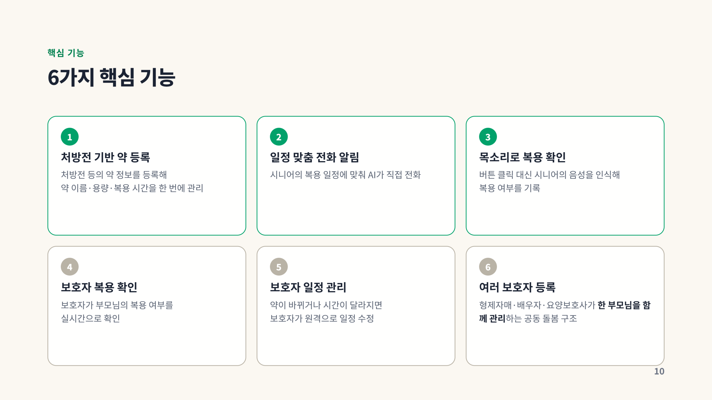
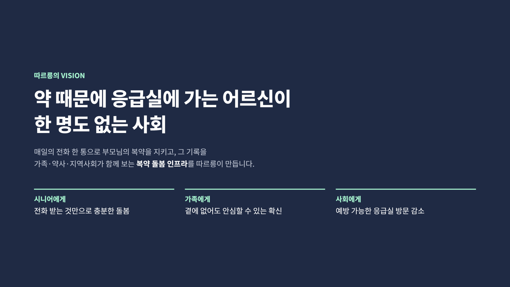

### 📞 전화 한 통으로 지키는 부모님의 복약 약속

**시니어에게는 익숙한 전화 한 통, 보호자에게는 안심할 수 있는 복약 기록.**

2026 LINE 4 HACKATHON · 멋쟁이사자처럼 14기 · 4호선톤 24팀

## 📌 Project Information

| 항목 | 내용 |
| :--- | :--- |
| 📞 **프로젝트명** | 따르릉 (Ttareureung) |
| 🗓️ **개발 기간** | 2026.11.06 ~ 2026.11.20 |
| 🚀 **배포 주소** | [따르릉 바로가기](https://ttareureung.vercel.app/) |
| 💻 **Frontend** | [GitHub](https://github.com/Line4Thon-Team24/TTAREUREUNG-CLIENT) |
| ⚙️ **Backend** | [GitHub](https://github.com/Line4Thon-Team24/TTAREUREUNG-SERVER) |
| 🦁 **소속** | 멋쟁이사자처럼 14기 · 4호선톤 24팀 |

---

## 💚 About 따르릉

**따르릉**은 여러 약을 제때 복용하기 어려운 시니어와 멀리서 부모님의 복약 여부를 확인해야 하는 보호자를 연결하는 **AI 전화 기반 복약 관리 서비스**입니다.

시니어는 복잡한 앱을 매번 조작하는 대신 **전화를 받고 목소리로 대답**하며, 보호자는 **처방전 기반 복용 일정과 복용 기록을 관리**하고 가족·돌봄 담당자와 함께 확인할 수 있도록 설계했습니다.

### 🔎 Problem

**혼자 사는 고령자는 여러 약을 제때 먹지 못하고, 멀리 사는 자녀는 부모님이 약을 드셨는지 알 방법이 없습니다.**

- **시니어** — 약은 많고, 복용 시간을 기억하기 어렵고, 매번 앱을 조작하는 것도 부담스럽습니다.
- **보호자** — 매일 전화로 확인하기 어렵고, 가족끼리 복약 정보가 분산되기 쉽습니다.
- **사회** — 다제약물 복용자는 늘지만 전문적인 복약 관리가 닿는 범위는 제한적입니다.

## 📞 How It Works

**처방전 등록 → AI 전화 → 카메라로 약 확인 → 음성으로 복용 확인 → 보호자 공유**

| 단계 | 내용 |
| :---: | --- |
| **01 · 약 등록** | 보호자가 처방전을 등록하면 AI가 복용 일정을 자동으로 설정하는 흐름을 목표로 합니다. |
| **02 · AI 전화** | 복용 시간에 맞춰 시니어의 휴대폰으로 AI가 먼저 전화해 복약을 안내합니다. |
| **03 · 카메라 확인** | 약을 카메라에 비춰 복용해야 할 약이 맞는지 AI로 확인하는 흐름입니다. |
| **04 · 음성 확인** | 시니어가 목소리로 복용 여부를 알려주면 기록합니다. |
| **05 · 보호자 공유** | 복용 결과를 연결된 보호자들이 함께 확인하도록 설계했습니다. |

## ✨ Key Features

- **💊 처방전 기반 약 등록** — 처방전 등의 약 정보를 등록해 약 이름·용량·복용 시간을 한 번에 관리
- **📞 일정 맞춤 전화 알림** — 시니어의 복용 일정에 맞춰 AI가 먼저 전화해 복약 안내
- **🎙️ 목소리로 복용 확인** — 버튼 클릭 대신 음성으로 복용 여부 기록
- **🔔 보호자 복용 확인** — 보호자 화면에서 부모님의 복용 여부 확인
- **📅 보호자 일정 관리** — 약이나 복용 시간이 바뀌면 보호자가 원격으로 수정
- **👨‍👩‍👧‍👦 여러 보호자 등록** — 형제자매·배우자·요양보호사 등이 함께 관리하는 공동 돌봄 구조

## 💬 User Scenario

**오후 3시, 김순자 어르신(76)의 복약 시간**

따르릉이 먼저 전화를 걸면, 시니어는 카메라로 약을 확인하고 **“다 먹었어”**라고 말합니다. 이후 다음 복용 시간을 안내받고, 연결된 보호자들은 복용 결과를 함께 확인할 수 있습니다.

## 🌱 Why 따르릉?

- **💊 안부가 아닌 복약에 집중** — 약 이름·시간·복용 여부를 중심으로 대화하고, 결과를 복용 기록으로 남기는 구조
- **👨‍👩‍👧‍👦 여러 보호자의 공동 돌봄** — 형제자매·요양보호사가 한 시니어의 복약 상태를 함께 관리
- **🏠 일반 가정이 직접 시작하는 B2C** — 기관 중심 돌봄 서비스와 달리 일반 가정의 직접 가입·이용을 목표로 설계

복용 기록이 쌓이면 **자주 놓치는 복용 시간대** 등의 패턴을 확인하고, 장기적으로 약국·의료진과 연결하는 복약 관리 플랫폼으로 확장하고자 합니다.

## 🎯 Target & Roadmap

**이용자는 시니어, 주된 결제자는 멀리 사는 보호자**라는 점에 집중합니다.

- **핵심 보호자** — 따로 사는 부모님의 복약 상태가 걱정되는 40~50대 자녀
- **핵심 시니어** — 여러 약을 복용하고 복잡한 스마트폰 조작이 부담스러운 고령자
- **확장 대상** — 약국, 방문요양센터, 지자체 등 돌봄 기관

**확장 방향:** 가정용 복약 관리(B2C) 검증 → 약국·약사 연계 → 기관·공공 돌봄(B2B·B2G) → 다국어 음성 지원 및 해외 확장

---

## 🛠 Tech Stack

### 💻 Frontend

  
  
  
  

### 📚 Frontend Library

  
  
  

### ⚙️ Backend

  
  
  
  
  
  

### 🗄️ Database

  

### 🤖 AI & External Services

  
  
  

### ☁️ Deployment & DevOps

  
  
  
  
  

### 🧰 Code Quality & Collaboration

  
  
  
  

---

## 👥 Team Members

**멋쟁이사자처럼 14기 · 4호선톤 24팀**

### 💻 Frontend

<table>
  <tr>
    <td align="center" width="220">
       
      <b>이연재</b> 
      🏫 숙명여대 
      Frontend Developer 
      <a href="https://github.com/lyeonj">@lyeonj</a>
    </td>
    <td align="center" width="220">
       
      <b>김승민</b> 
      🏫 서경대 
      Frontend Developer 
      <a href="https://github.com/seungminng12">@seungminng12</a>
    </td>
  </tr>
</table>

### ⚙️ Backend

<table>
  <tr>
    <td align="center" width="220">
       
      <b>양희창</b> 
      🏫 서경대 
      Backend Developer 
      <a href="https://github.com/hxx-dev">@hxx-dev</a>
    </td>
    <td align="center" width="220">
       
      <b>천유진</b> 
      🏫 덕성여대 
      Backend Developer 
      <a href="https://github.com/yulmoo75">@yulmoo75</a>
    </td>
  </tr>
</table>

## 🎯 Our Vision

### 약 때문에 응급실에 가는 어르신이 한 명도 없는 사회

**시니어에게는 전화 받는 것만으로 충분한 돌봄.**  
**가족에게는 곁에 없어도 안심할 수 있는 확신.**  
**사회에는 예방 가능한 응급실 방문 감소.**

매일의 전화 한 통으로 복약을 지키고, 그 기록을 가족·약사·지역사회가 함께 보는 복약 돌봄 인프라를 지향합니다.

