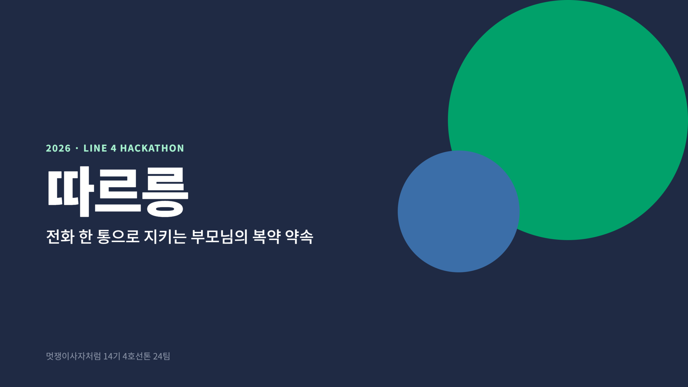
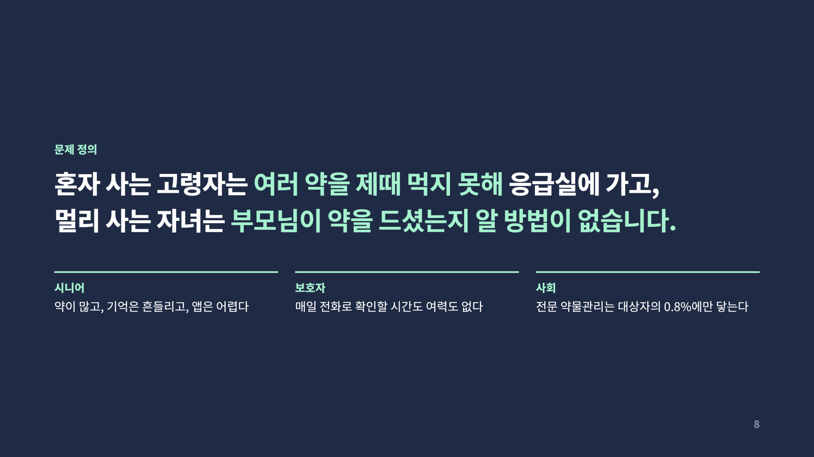
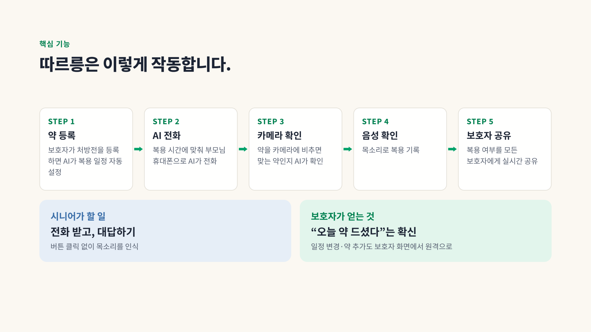

### 📞 전화 한 통으로 지키는 부모님의 복약 약속

**시니어에게는 익숙한 전화 한 통, 보호자에게는 안심할 수 있는 복약 기록.**

2026 LINE 4 HACKATHON · 멋쟁이사자처럼 14기 · 4호선톤 24팀

## 📌 Project Information

| 항목 | 내용 |
| :--- | :--- |
| 📞 **프로젝트명** | 따르릉 (Ttareureung) |
| 🗓️ **개발 기간** | 2026.11.06 ~ 2026.11.20 |
| 🚀 **배포 주소** | [따르릉 바로가기](https://ttareureung.vercel.app/) |
| 💻 **Frontend** | [GitHub](https://github.com/Line4Thon-Team24/TTAREUREUNG-CLIENT) |
| ⚙️ **Backend** | [GitHub](https://github.com/Line4Thon-Team24/TTAREUREUNG-SERVER) |
| 🦁 **소속** | 멋쟁이사자처럼 14기 · 4호선톤 24팀 |

---

## 💚 About 따르릉

**따르릉**은 복약 시간을 놓치기 쉬운 시니어와 멀리서 부모님을 돌보는 보호자를 연결하는 **AI 전화 기반 복약 관리 서비스**입니다.

시니어는 복잡한 화면 조작 대신 전화를 받고 목소리로 응답하고, 보호자는 복용 일정 및 기록을 확인하며 가족·돌봄 담당자와 정보를 공유할 수 있도록 기획했습니다.

## 📞 How It Works

**약 등록 → AI 전화 → 카메라 확인 → 음성 확인 → 보호자 공유**

| 단계 | 내용 |
| :---: | --- |
| **01 · 약 등록** | 보호자가 처방전·약 정보를 등록하고 복용 일정을 관리합니다. |
| **02 · AI 전화** | 복용 시간에 맞춰 AI 전화로 복약을 안내하는 흐름을 지향합니다. |
| **03 · 카메라 확인** | 촬영한 약 사진을 AI로 확인합니다. |
| **04 · 음성 확인** | 시니어의 음성으로 복용 여부를 기록합니다. |
| **05 · 보호자 공유** | 보호자에게 복용 결과와 미복용 알림을 공유합니다. |

## ✨ Key Features

- **💊 처방전 기반 약 등록** — 약 이름, 용량, 복용 시간을 한 곳에서 관리
- **📞 일정 맞춤 알림** — 복용 시간에 맞춰 시니어에게 안내
- **🎙️ 음성 복용 확인** — 목소리로 복용 여부 입력
- **🔔 보호자 복용 확인** — 완료·미복용 등 복약 상태 확인
- **📅 보호자 일정 관리** — 보호자 화면에서 복용 일정 수정
- **👨‍👩‍👧‍👦 여러 보호자 등록** — 가족 및 돌봄 담당자의 공동 관리

## 💬 User Scenario

복용 시간을 놓친 시니어에게 다시 안내하고, 확인된 복용 상태를 여러 보호자에게 전달하는 사용 흐름입니다.

## 🌱 Why 따르릉?

- **복약 중심** — 안부 확인을 넘어 약 이름·시간·복용 여부에 집중
- **공동 돌봄** — 여러 보호자가 한 시니어의 복약 상태를 함께 관리
- **쉬운 접근** — 시니어에게 익숙한 전화·음성 중심 경험

---

## 🛠 Tech Stack

### 💻 Frontend

  
  
  
  

### 📚 Frontend Library

  
  
  

### ⚙️ Backend

  
  
  
  
  
  

### 🗄️ Database

  

### 🤖 AI & External Services

  
  
  

### ☁️ Deployment & DevOps

  
  
  
  
  

### 🧰 Code Quality & Collaboration

  
  
  
  

---

## 👥 Team Members

**멋쟁이사자처럼 14기 · 4호선톤 24팀**

### 💻 Frontend

<table>
  <tr>
    <td align="center" width="220">
       
      <b>이연재</b> 
      🏫 성신여대  
      Frontend Developer 
      <a href="https://github.com/lyeonj">@lyeonj</a>
    </td>
    <td align="center" width="220">
       
      <b>김승민</b> 
      🏫 서경대  
      Frontend Developer 
      <a href="https://github.com/seungminng12">@seungminng12</a>
    </td>
  </tr>
</table>

### ⚙️ Backend

<table>
  <tr>
    <td align="center" width="220">
       
      <b>양희창</b> 
      🏫 서경대  
      Backend Developer 
      <a href="https://github.com/hxx-dev">@hxx-dev</a>
    </td>
    <td align="center" width="220">
       
      <b>천유진</b> 
      🏫 덕성여대  
      Backend Developer 
      <a href="https://github.com/yulmoo75">@yulmoo75</a>
    </td>
  </tr>
</table>

## 🎯 Our Vision

**전화 받는 것만으로 충분한 돌봄.**  
**곁에 없어도 안심할 수 있는 확신.**

따르릉 · 전화 한 통으로 지키는 부모님의 복약 약속

