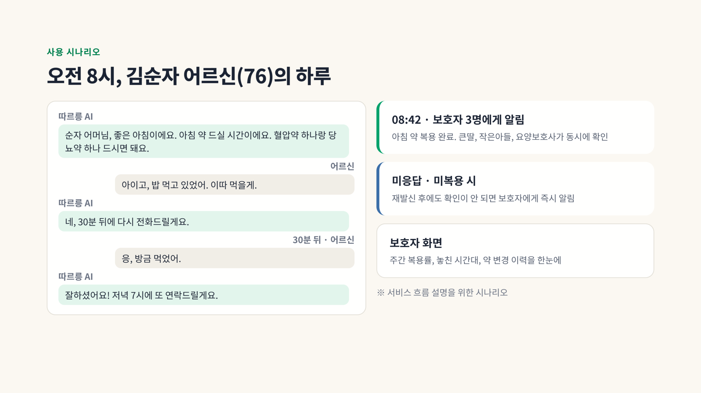
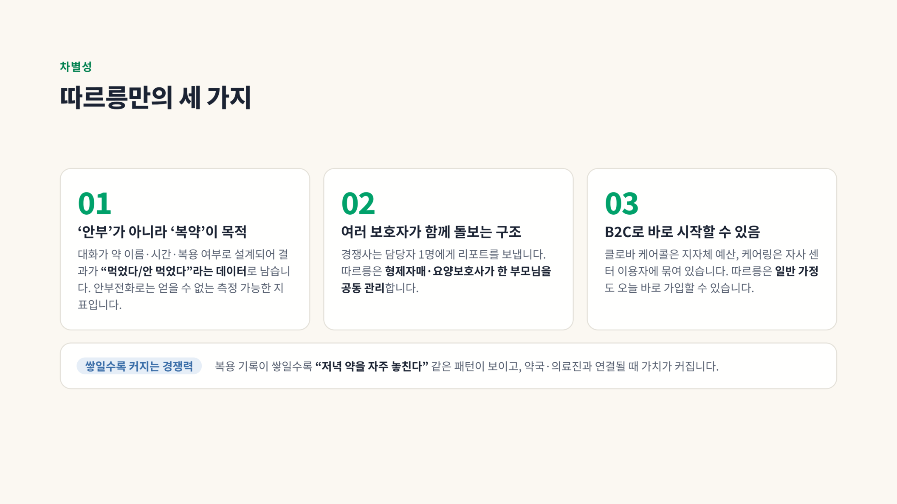

### 📞 전화 한 통으로 지키는 부모님의 복약 약속

**시니어에게는 익숙한 전화 한 통, 보호자에게는 안심할 수 있는 복약 기록.**

2026 LINE 4 HACKATHON · 멋쟁이사자처럼 14기 · 4호선톤 24팀

---

## 💚 About 따르릉

**따르릉**은 복약 시간을 놓치기 쉬운 시니어와 멀리서 부모님을 돌보는 보호자를 연결하는 **AI 전화 기반 복약 관리 서비스**입니다.

시니어는 복잡한 화면 조작 대신 전화를 받고 목소리로 응답하고, 보호자는 복용 일정 및 기록을 확인하며 가족·돌봄 담당자와 정보를 공유할 수 있도록 기획했습니다.

## 📞 How It Works

**약 등록 → AI 전화 → 카메라 확인 → 음성 확인 → 보호자 공유**

| 단계 | 내용 |
| :---: | --- |
| **01 · 약 등록** | 보호자가 처방전·약 정보를 등록하고 복용 일정을 관리합니다. |
| **02 · AI 전화** | 복용 시간에 맞춰 AI 전화로 복약을 안내하는 흐름을 지향합니다. |
| **03 · 카메라 확인** | 촬영한 약 사진을 AI로 확인합니다. |
| **04 · 음성 확인** | 시니어의 음성으로 복용 여부를 기록합니다. |
| **05 · 보호자 공유** | 보호자에게 복용 결과와 미복용 알림을 공유합니다. |

## ✨ Key Features

- **💊 처방전 기반 약 등록** — 약 이름, 용량, 복용 시간을 한 곳에서 관리
- **📞 일정 맞춤 알림** — 복용 시간에 맞춰 시니어에게 안내
- **🎙️ 음성 복용 확인** — 목소리로 복용 여부 입력
- **🔔 보호자 복용 확인** — 완료·미복용 등 복약 상태 확인
- **📅 보호자 일정 관리** — 보호자 화면에서 복용 일정 수정
- **👨‍👩‍👧‍👦 여러 보호자 등록** — 가족 및 돌봄 담당자의 공동 관리

> 위 핵심 기능과 아래 시나리오는 IR Deck의 **서비스 목표·기획**을 담았습니다. 개발에 사용한 기술과 개별 기능의 운영 배포 여부가 모두 동일하다는 의미는 아닙니다.

## 💬 User Scenario

복용 시간을 놓친 시니어에게 다시 안내하고, 확인된 복용 상태를 여러 보호자에게 전달하는 사용 흐름입니다.

## 🌱 Why 따르릉?

- **복약 중심** — 안부 확인을 넘어 약 이름·시간·복용 여부에 집중
- **공동 돌봄** — 여러 보호자가 한 시니어의 복약 상태를 함께 관리
- **쉬운 접근** — 시니어에게 익숙한 전화·음성 중심 경험

---

## 🛠 Tech Stack

### 💻 Frontend

| 기술 | 적용 영역 |
| --- | --- |
| **React 19 · TypeScript 6.0** | 전체 화면 및 타입 기반 UI 개발 |
| **Vite 8** | 로컬 개발 서버 및 프로덕션 빌드 |
| **React Router 7** | `createBrowserRouter`, 페이지 이동, 라우트 가드 |
| **Tailwind CSS 4** | UI 스타일링 및 `@theme` 디자인 토큰 |
| **Axios 1** | API 클라이언트, 토큰 재발급 인터셉터 |
| **lucide-react** | UI 아이콘 |

#### Browser APIs & PWA

| 기술 | 적용 영역 |
| --- | --- |
| **Service Worker + Web Push (VAPID)** | 보호자 푸시 알림 수신 및 알림 클릭 시 화면 이동 |
| **Notification API** | 보호자 대상 알림 권한 요청 |
| **Web App Manifest** | 홈 화면 설치 및 앱 아이콘 |
| **Web Speech API (TTS / STT)** | 시니어 음성 안내 및 음성 입력 |
| **MediaDevices / Camera API** | 약·처방전 촬영 (`getUserMedia`, `capture`) |
| **sessionStorage** | 선택한 보호자·시니어 프로필 유지 |

#### Frontend Tools

- **Code Quality** — ESLint 10, typescript-eslint, react-hooks, react-refresh, Prettier 3 및 Tailwind 클래스 정렬 플러그인
- **Local HTTPS** — `@vitejs/plugin-basic-ssl` 기반 카메라·푸시 기능 테스트
- **Deployment & Design** — Vercel (`vercel.json`), Figma

### ⚙️ Backend

| 구분 | 기술 및 역할 |
| --- | --- |
| **Language & Framework** | Java 21, Spring Boot 4.1.2, Gradle |
| **Persistence** | Spring Data JPA (Hibernate), MySQL 8.0 (`utf8mb4`), `ddl-auto: update` |
| **Validation & Utils** | Spring Validation, Jackson 3, Lombok |
| **Security** | Spring Security, OAuth2 Resource Server, JWT (HS256 / Nimbus), BCrypt |
| **Token Management** | Access Token 30분, Refresh Token 7일 (HttpOnly 쿠키·회전) |
| **HTTP Security** | CORS 설정 및 `X-Requested-With`를 이용한 refresh/logout CSRF 방어 |

### 🤖 AI · External Services

| 기술 | 적용 영역 |
| --- | --- |
| **Google Gemini API** | 처방전·약봉투 인식, 복용 약 사진 판독 |
| **AWS S3** | Presigned URL 기반 파일 저장 (키 미설정 시 서버 디스크 및 서명 링크 대체) |
| **Web Push (VAPID)** | RFC 8291 `aes128gcm` 암호화 기반 푸시 |
| **Spring Scheduling** | 복용 시간 알림을 위한 1분 주기 스케줄러 |
| **Spring RestClient · Java HttpClient** | 외부 HTTP 통신 |

### ☁️ Infrastructure & DevOps

| 기술 | 적용 영역 |
| --- | --- |
| **Docker / Docker Compose** | Temurin 21 기반 멀티 스테이지 빌드, 컨테이너 운영 |
| **Docker Hub** | 멀티 아키텍처 이미지 레지스트리 |
| **AWS EC2 (Ubuntu)** | 백엔드 애플리케이션 호스팅 |
| **Nginx** | HTTPS 및 리버스 프록시 |
| **GitHub Actions (CI)** | PR / `develop` 브랜치 빌드·테스트, MySQL 서비스 컨테이너 |
| **GitHub Actions (CD)** | `main` 푸시 → 이미지 빌드·푸시 → EC2 SSH → `docker compose up -d` |
| **CodeRabbit** | 코드 리뷰 |

### 🧪 Testing & API Documentation

| 도구 | 적용 영역 |
| --- | --- |
| **JUnit 5 · Spring Boot Test · MockMvc** | 백엔드 통합 테스트 **272개** |
| **springdoc-openapi 3.2.0** | Swagger UI 기반 API 문서 |
| **Spring Boot Actuator** | Health Check |

---

## 👥 Team Members

**멋쟁이사자처럼 14기 · 4호선톤 24팀**

| 이름 | 담당 영역 | 역할 |
| :---: | --- | :---: |
| **양희창** | 로그인 및 시니어 기능 | Backend |
| **천유진** | 배포 및 보호자 기능 | Backend |

<!-- 프론트엔드 팀원 이름 및 GitHub ID가 확인되면 위 표에 추가하세요. -->

## 🔗 Repositories

<!-- 조직명과 실제 레포지토리 경로 확인 후 아래 링크를 채워주세요. -->
- **Frontend:** 링크 추가 예정
- **Backend:** 링크 추가 예정

## 🎯 Our Vision

**전화 받는 것만으로 충분한 돌봄.**  
**곁에 없어도 안심할 수 있는 확신.**

따르릉 · 전화 한 통으로 지키는 부모님의 복약 약속

